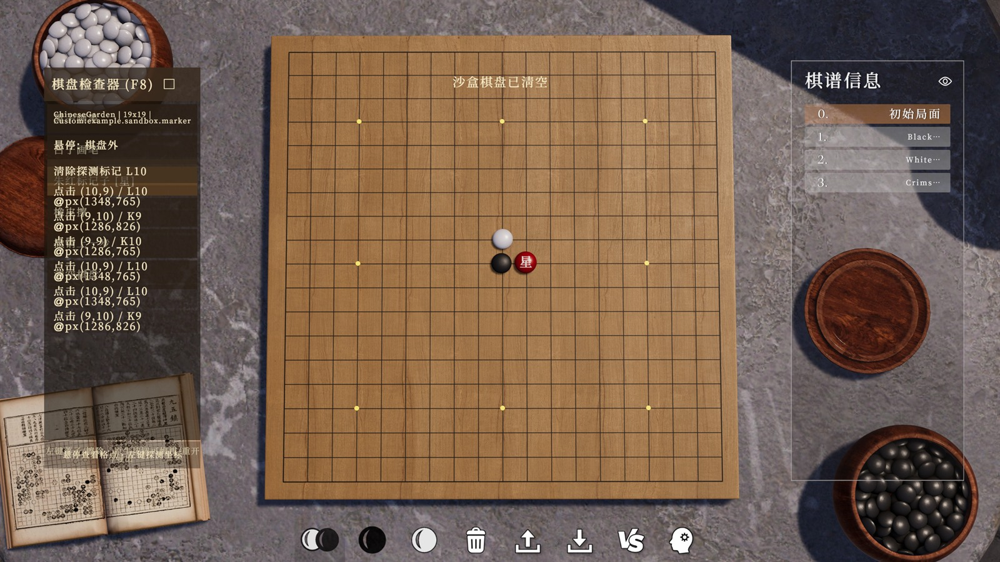
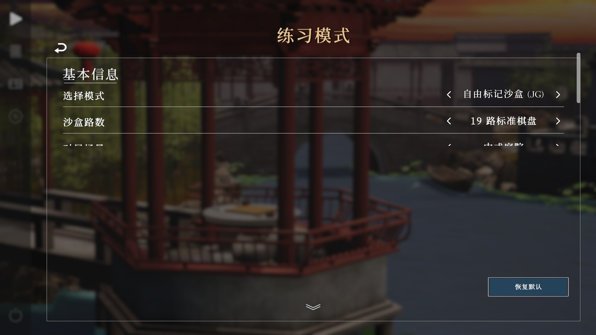
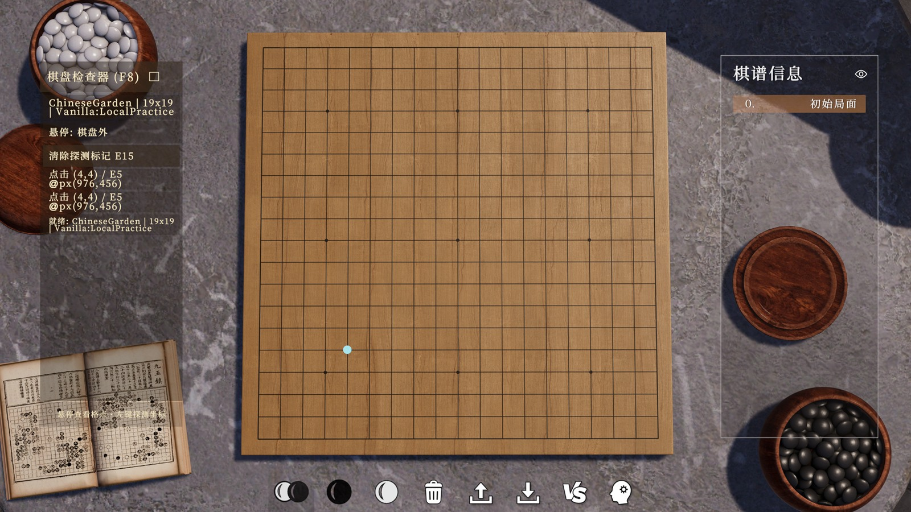
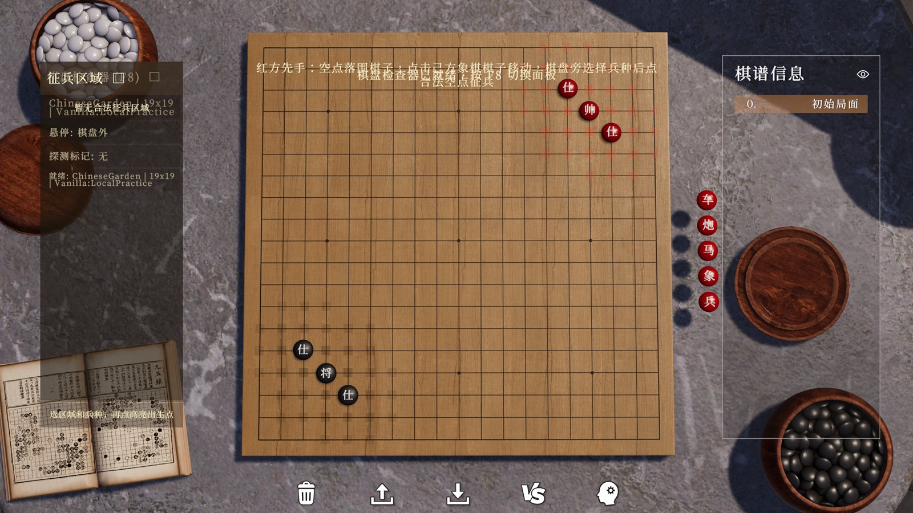

<div align="center">

# Just Gone

**The Just Go Modding Extension**

*One board. Many possibilities.*

[](https://github.com/MingqiZhang0/JustGone/releases/tag/v0.1.0)
[](#scope-and-limitations)
[](LICENSE)
[](#requirements)
[](#requirements)
[](#requirements)

**English** · [简体中文](README.zh-CN.md)

[Why Just Gone](#why-just-gone) · [Quick Start](#quick-start) · [API](#api-overview) · [Showcase](#showcase) · [Architecture](#architecture)

</div>

---

**Just Gone** is a shared BepInEx 5 and Harmony modding extension for the Unity game *Just Go*. Inspired in role by community modding extensions such as REPENTOGON — while built independently in C# for BepInEx and HarmonyX — it lets mod developers register custom game modes, build native-styled menus and sidebars, query board coordinates, render custom pieces and 3D markers, and coexist cleanly with vanilla gameplay and existing mods by referencing only `JustGone.dll`.

This release is **`v0.1.0` (Developer Preview)**. All 12 public services are backed by real runtime implementations and verified in isolated Unity coexistence testing, but binary and source compatibility are not guaranteed prior to `1.0.0`.

<p align="center">
  
</p>

## Why Just Gone

Building a non-trivial *Just Go* mod from scratch normally requires every author to reverse-engineer internal `Assembly-CSharp` methods, board coordinate transforms, `ModeSelection_LM` routing, native `BasicPanel` layouts, input suppression, scene lifecycles, and Harmony patch ordering — and then hope two mods do not break each other's hooks or corrupt vanilla saves.

Just Gone consolidates these shared mechanics behind a public, mod-scoped API so third-party mods do not need to reference `Assembly-CSharp.dll` or write duplicate Harmony patches.

| Common modding challenge | What Just Gone provides |
| --- | --- |
| Reverse-engineering board coordinates and raycasts | **Board API** (`JustGoneApi.Board`) for 9/13/19 boards, GTP, local/world/screen transforms, and picking |
| Creating custom game modes | **GameMode API** (`JustGoneApi.Modes`) with menu registration, session lifecycle, and failsafe teardown |
| Integrating native menus and panels | **Menu and UI APIs** (`JustGoneApi.Menu`, `JustGoneApi.UI`) for `BasicPanel` config pages, mirrored sidebars, toasts, and history |
| Managing custom pieces and overlays | **Piece and Rendering APIs** (`JustGoneApi.Pieces`, `JustGoneApi.Rendering`) reusing native stone prefabs, CJK labels, markers, and hover ghosts |
| Handling input conflicts across mods | **Input API** (`JustGoneApi.Input`) with UI/focus checks and reference-counted vanilla input locks |
| Managing scene-owned objects and fonts | **Scene and Resource APIs** (`JustGoneApi.Scene`, `JustGoneApi.Resources`) plus LIFO `ModContext` cleanup |
| Protecting vanilla saves and existing mods | **SaveGuard API** (`JustGoneApi.Saves`) with ES3 Compare-And-Set transactions and `Priority.High` coexistence routing |

## Quick Start

### For Players

1. Make sure **BepInEx 5** (`5.4.23.6` with `0Harmony 2.9.0.0`) is installed in your *Just Go* directory and the game is closed.
2. Download **`JustGone-v0.1.0-Runtime.zip`** from the [v0.1.0 Release](https://github.com/MingqiZhang0/JustGone/releases/tag/v0.1.0) and extract it.
3. Install using either method:
   - **Recommended (transactional install with version and SHA-256 verification):**
     ```powershell
     & '.\tools\install.ps1' -GameDir '<Your Just Go Directory>' -From '.\plugins\JustGone\JustGone.dll' -ExpectedVersion '0.1.0.0' -ExpectedSha256 '<see SHA256SUMS.txt>'
     ```
   - **Manual install:** copy `plugins\JustGone\` into `<Your Just Go Directory>\BepInEx\plugins\JustGone\`.
4. **Uninstall:** close *Just Go* and delete `<Your Just Go Directory>\BepInEx\plugins\JustGone\` (or run `tools/deploy-lib.ps1 -Mode Remove`). Vanilla files, vanilla saves, and other plugins (such as *WeiXiangQi*) are never modified.

### For Mod Developers

1. Download **`JustGone-v0.1.0-SDK.zip`** from [Releases](https://github.com/MingqiZhang0/JustGone/releases/tag/v0.1.0), which includes `lib/net472/JustGone.dll`, XML documentation (`JustGone.xml`), developer docs, and the standalone starter template `templates/JustGoneModTemplate/`.
2. Reference `JustGone.dll`, `BepInEx.dll`, `UnityEngine.dll`, and `UnityEngine.CoreModule.dll` with `<Private>false</Private>` — no `Assembly-CSharp.dll` or `0Harmony.dll` required.
3. Declare `[BepInDependency(JustGoneApi.FrameworkGuid)]` and register an isolated `ModContext`:

```csharp
using BepInEx;
using JustGone;
using JustGone.Core;
using UnityEngine;

namespace MyJustGoneMod
{
    [BepInPlugin("author.justgone.template", "My Just Gone Mod", "0.1.0")]
    [BepInDependency(JustGoneApi.FrameworkGuid)]
    public sealed class MyModPlugin : BaseUnityPlugin
    {
        private ModContext _ctx;
        private IMarkerLayer _markers;

        private void Awake()
        {
            _ctx = JustGoneApi.RegisterMod("author.justgone.template", "My Just Gone Mod", "0.1.0");
            _ctx.Log.Info("Template MOD initialized.");

            JustGoneApi.Events.OnGameReady(_ctx, OnGameReady);
            JustGoneApi.Events.OnBoardClicked(_ctx, OnBoardClicked);
            JustGoneApi.Events.OnGameLeaving(_ctx, _ => CleanupBoardResources());
        }

        private void OnGameReady(GameReadyEventArgs e)
        {
            CleanupBoardResources();
            _markers = JustGoneApi.Rendering.CreateMarkerLayer(_ctx, "template_markers");
            JustGoneApi.UI.ShowToast("My Just Gone Mod ready (" + e.BoardSize + "x" + e.BoardSize + ")", 2.5f);
        }

        private void OnBoardClicked(BoardClickEventArgs e)
        {
            if (e.PointerOverUi || e.MouseButton != 0 || !e.Coord.IsValid) return;
            _markers?.Clear();
            _markers?.SetMarker(e.Coord, Color.cyan, diameterScale: 0.85f);
            JustGoneApi.UI.ShowToast("Clicked " + e.Coord.ToGtp(e.BoardSize) + " " + e.Coord, 1.8f);
        }

        private void CleanupBoardResources()
        {
            _markers?.Dispose();
            _markers = null;
        }

        private void OnDestroy()
        {
            CleanupBoardResources();
            _ctx?.Dispose();
        }
    }
}
```

4. Build the `net472` project and drop the output `.dll` into `<Your Just Go Directory>\BepInEx\plugins\<YourMod>\`. See the [Developer Guide](docs/DEVELOPER_GUIDE.md) for custom game modes, native config pages, and multi-mod guidelines.

## API Overview

All runtime services are exposed through the static `JustGoneApi` facade (`FrameworkGuid = "dev.justgone.framework"`). For full signatures and pure-logic `JustGone.Core` types, see [API_CATALOG.md](docs/API_CATALOG.md) and the per-method verification matrix in [PHASE2_ACCEPTANCE_REPORT.md](docs/PHASE2_ACCEPTANCE_REPORT.md).

| Service | Property | Summary | Verification Status |
| --- | --- | --- | --- |
| **Game** | `JustGoneApi.Game` | Match state, pause state, vanilla mode/environment queries, virtual camera, and safe return to main menu | Real Unity verified (`PauseOrResume` / `TrySetCamera` offline) |
| **Scene** | `JustGoneApi.Scene` | Current scene identity and safe scene transitions with native music fade and loading screen | Real Unity verified (non-`ChineseGarden` scenes pending) |
| **Board** | `JustGoneApi.Board` | Dynamic 9/13/19 board sizing, local/world/screen transforms, GTP conversion, raycast picking, and vanilla stone clearing | Real Unity verified (board scenes only) |
| **Piece** | `JustGoneApi.Pieces` | Scoped native stone layers (tinting, CJK glyph labels, scaling, animations, drop audio) and 3D display shelves | Real Unity verified (`CreateDisplayShelf` / `Move` / `UpdateVisual` offline) |
| **Rendering** | `JustGoneApi.Rendering` | 3D board cell highlight markers, native ownership grid overlays, and hover ghost stones | Real Unity verified (`CreateGridOverlay` offline, scene-dependent) |
| **Input** | `JustGoneApi.Input` | Pointer-over-UI and text-input focus checks, reference-counted vanilla input locks, and menu wheel absorbers | Real Unity verified (`RegisterMenuWheelAbsorber` offline) |
| **Menu** | `JustGoneApi.Menu` | Main menu mode registration (`ModeSelection_LM`) and native `BasicPanel` scrollable config page builder | Real Unity verified (MainMenu local practice panel) |
| **UI** | `JustGoneApi.UI` | Native toasts, sticky errors, mirrored collapsible sidebars, Practice buttons/history, game-over panel, and native save dialog | Real Unity verified (`ShowSaveFileDialog` / `ShowGameOver` / `StickyError` offline) |
| **GameMode** | `JustGoneApi.Modes` | End-to-end custom game mode registration, launch orchestration, session lifecycle, and failsafe abort | Real Unity verified (1 active custom mode at a time) |
| **Event** | `JustGoneApi.Events` | Exception-isolated event bus for scene, game ready/leaving, board hover/click, key, wheel, pause, and native actions | Real Unity verified |
| **Resource** | `JustGoneApi.Resources` | Dynamic CJK/TextMeshPro font discovery, native prefab availability checks, and per-mod config directories | Real Unity verified |
| **SaveGuard** | `JustGoneApi.Saves` | Compare-And-Set transaction backup, rollback, and startup reconciliation for vanilla `SaveFileOfficial_beta.es3` | Real Unity verified (vanilla launch keys only) |

## Showcase

Both reference example mods in [`src/Examples/`](src/Examples/) are compile-time verified to have **zero direct references** to `Assembly-CSharp.dll`, `0Harmony.dll`, or `JustGoWeiXiangQiP4.dll`. All screenshots below are unedited captures from real Unity (`v1.2.0`) isolated acceptance runs.

### Custom Game Modes (`JustGone.Example.CustomModeAndUi`)

Registers a custom mode (*自由标记沙盒 (JG)*) in the native Practice mode selector with a scrollable `BasicPanel` config page, spawns native black/white stones alongside a crimson CJK-labeled stone (`星`) and 9 star-point markers, and binds native `Undo`, `Restart`, and right-hand history controls.

<p align="center">
  
  
</p>

### Board Inspector (`JustGone.Example.BoardInspector`)

Runs non-invasively alongside vanilla or custom modes, displaying live board size, environment, hover coordinates, GTP/screen pixel readouts in a toggleable (`F8`) native sidebar, and placing a cyan 3D probe marker on click.

<p align="center">
  
</p>

### Compatibility with WeiXiangQi

Just Gone and both example mods running in the same Unity process alongside standalone ***WeiXiangQi* (`JustGoWeiXiangQiP4.dll` v0.10.10.0)**. Vanilla modes 0 and 1, WeiXiangQi (index 2), and Just Gone custom modes (index 3+) coexist in `ModeSelection_LM` with zero hook interference.

<p align="center">
  
</p>

## Architecture

```text
Third-Party Mods (isolated ModContext)
                 |
      JustGoneApi (Public Facade)
                 |
        12 Runtime Services  <---->  JustGone.Core (Pure Logic, zero Unity deps)
                 |
  Internal Integration (JgPatches / JgBootstrap / JgMenuHost / JgGameBridge)
                 |
       BepInEx 5 + HarmonyX + Unity Mono
                 |
              Just Go
```

| Layer | Location | Responsibility |
| --- | --- | --- |
| **Pure Core** | [`src/JustGone.Core/`](src/JustGone.Core/) | Unity-free coordinates (`BoardCoord`), multi-mod `MenuRouteTable`, `SessionGuard`, CAS `SaveTransactionRules`, `AtomicFileWriter`, `MiniJson`, `PieceLedger<TData>`, and `InputLockRegistry` |
| **Public Facade & Services** | [`src/JustGone/`](src/JustGone/), [`src/JustGone/Services/`](src/JustGone/Services/) | `JustGoneApi`, `ModContext`, and all 12 runtime services shielding mods from `Assembly-CSharp` internals |
| **Internal Integration** | [`src/JustGone/Internal/`](src/JustGone/Internal/) | Centralized Harmony hooks (`JgPatches`), `DontDestroyOnLoad` runner (`JgBootstrap`), `BasicPanel` menu host (`JgMenuHost`), reflection bridge, and failsafe |
| **Examples & Template** | [`src/Examples/`](src/Examples/), [`templates/JustGoneModTemplate/`](templates/JustGoneModTemplate/) | Zero-`Assembly-CSharp` reference mods and standalone SDK starter project |

Key runtime invariants:
- **Per-mod ownership (`ModContext`)**: Event subscriptions, input locks, piece/marker layers, sidebars, and menu registrations are tracked per mod and disposed in LIFO order on `Dispose()`.
- **Exception isolation**: Each event subscriber runs inside an isolated `try/catch`; a failing mod cannot block other mods or vanilla callbacks.
- **Vanilla & coexistence pass-through**: `TitleManager.LoadLocalMultiMatch` is patched at `Priority.High` and only intercepts modes registered through Just Gone, passing vanilla modes (0/1) and standalone *WeiXiangQi* (index 2) through untouched. Initialization failures roll back via `harmony.UnpatchSelf()` only.
- **Save protection (`SaveGuard`)**: Custom mode launches snapshot and verify `SaveFileOfficial_beta.es3` via Compare-And-Set under `BepInEx/config/dev.justgone.framework/es3-guard/` and restore on exit or crash recovery.

See [ARCHITECTURE.md](docs/ARCHITECTURE.md) for the complete Harmony patch table and coexistence design.

## Scope and Limitations

Just Gone `v0.1.0` is a **Developer Preview**, not a production-stable `1.0` release.

| Area | Current Status |
| --- | --- |
| **Verified game & runtime** | *Just Go* v1.2.0 (Unity 2021.3.29f1 Mono, Windows x64), BepInEx 5.4.23.6, 0Harmony 2.9.0.0 |
| **Verified board sizes** | 9×9, 13×13, and 19×19 coordinate transforms and raycast picking verified in real Unity |
| **Verified coexistence** | Vanilla modes 0 & 1, *WeiXiangQi* v0.10.10.0 (index 2), Just Gone custom sandbox (index 3), and `BoardInspector` in a single process |
| **Real Unity automated report** | **63/65 assertions passed** in Phase 2 acceptance; 2 failures were harness-side index expectations (`LocalMultiBoardSizeSelector` `0=9, 1=13, 2=19` vs. ES3 `0=19, 1=13, 2=9`), while all three board sizes were entered and verified |
| **Unverified interactive UI** | `ShowSaveFileDialog` (native OS file dialog), `ShowGameOver`, `CreateDisplayShelf`, `CreateGridOverlay`, `PauseOrResume`, and `TrySetCamera` are compiled and offline-checked, not yet interactively verified in automated Unity runs |
| **API stability** | Public signatures and namespaces may change before `1.0.0` |
| **Known UI & runtime limits** | Multiple mods mirroring the left sidebar or showing toasts concurrently can overlap (use a toggle hotkey like `F8` or custom anchors); initial `BasicPanel/List` viewport height depends on the first captured vanilla mode; default English TMP font lacks `▾`/`▸` glyphs (renders as `□`); only 1 active custom game mode is supported at a time |

Full evidence and per-API status are documented in [PHASE2_ACCEPTANCE_REPORT.md](docs/PHASE2_ACCEPTANCE_REPORT.md).

## Requirements

| Context | Requirements |
| --- | --- |
| **Runtime (Players)** | *Just Go* v1.2.0 (Windows x64, Unity 2021.3.29f1 Mono) · BepInEx 5.4.23.6 (includes 0Harmony 2.9.0.0) |
| **Mod Development (SDK)** | .NET SDK supporting `net472` (C# 8.0) · `JustGone.dll` (from SDK) · `BepInEx.dll`, `UnityEngine.dll`, `UnityEngine.CoreModule.dll` from a local *Just Go* install |
| **Framework Source Build** | .NET SDK 8/10+ with `net472` reference assemblies · Local *Just Go* v1.2.0 + BepInEx 5 installation (for compile-time `Private=false` references) |

## Development

Clone the repository and run the build, unit tests, and deployment transaction self-tests from the repository root:

```powershell
git clone https://github.com/MingqiZhang0/JustGone.git
cd JustGone

# Run JustGone.Core unit tests (12/12), build JustGone + both example mods (net472),
# and verify zero Assembly-CSharp / 0Harmony references on examples
& '.\tools\build.ps1'

# Run transactional deployment and rollback self-tests (11/11 assertions in a temp directory)
& '.\tools\test-deployment.ps1'

# Package Runtime, SDK, and Examples release archives with hygiene scan and SHA-256 manifest
& '.\tools\package-release.ps1' -Version '0.1.0'
```

Override the default game installation path defined in [`Directory.Build.props`](Directory.Build.props) via `-p:GameDir="D:\Path\To\Just Go"` when building directly with `dotnet build`.

**Repository guide:** [`src/JustGone.Core/`](src/JustGone.Core/) · [`src/JustGone/`](src/JustGone/) · [`src/Examples/`](src/Examples/) · [`templates/JustGoneModTemplate/`](templates/JustGoneModTemplate/) · [`tests/JustGone.Core.Tests/`](tests/JustGone.Core.Tests/) · [`tools/`](tools/) · [`docs/`](docs/) · [`CHANGELOG.md`](CHANGELOG.md)

## Roadmap

`v0.1.0` establishes the Developer Preview baseline. Future work will be driven by real mod developer needs rather than speculative promises — candidate areas include shared multi-mod sidebar/toast layout coordination, read-only vanilla move observation hooks, additional menu extension points, and `dotnet new` template packaging. See [ROADMAP.md](docs/ROADMAP.md) for current notes.

## Contributing and Security

Issues, pull requests, and mod compatibility reports are welcome. When reporting a compatibility issue, please include your *Just Go* version, BepInEx version, installed mod list, and minimal reproduction steps.

**Never commit or attach** vanilla game assemblies (`Assembly-CSharp.dll`, `UnityEngine*.dll`, etc.), real player save files (`*.es3`), API keys, credentials, or private machine logs. For security concerns or potential save-corruption issues, please open a minimal issue without sensitive attachments or contact the maintainer directly.

## License and Acknowledgements

- **License**: Original source code and documentation in Just Gone are licensed under the [MIT License](LICENSE). Third-party runtime dependencies remain subject to their respective licenses; see [THIRD_PARTY_NOTICES.md](THIRD_PARTY_NOTICES.md).
- **Technical provenance**: Core *Just Go* integration patterns were extracted, decoupled, and generalized from the maintainer's first-party mod ***WeiXiangQi*** (`JustGo_WeiXiangQi` v0.10.10.0), with full 58-file traceability in [SOURCE_REUSE_MATRIX.md](docs/SOURCE_REUSE_MATRIX.md). Just Gone has zero runtime dependency on *WeiXiangQi* and does not include any *WeiXiangQi*-specific game rules.
- **Acknowledgements**: Built on [BepInEx 5](https://github.com/BepInEx/BepInEx) and [HarmonyX](https://github.com/BepInEx/HarmonyX) for Unity Mono, targeting *Just Go* by Studio Amateur.

*Just Gone is an unofficial community modding extension and is not affiliated with, endorsed by, or representative of the original developers of Just Go.*
