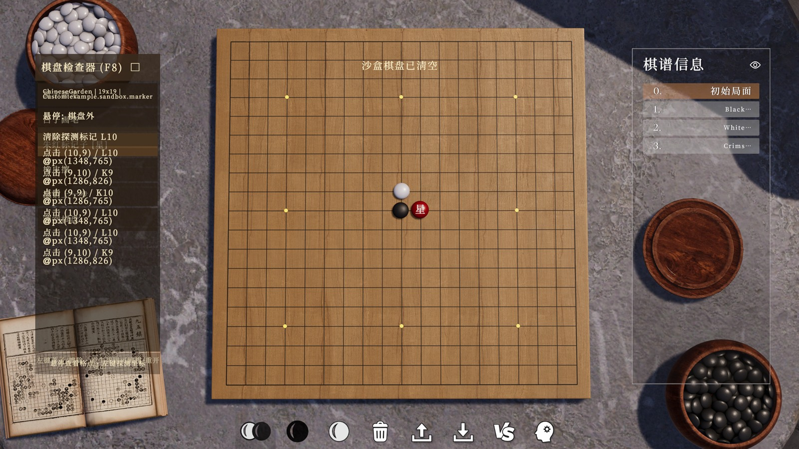
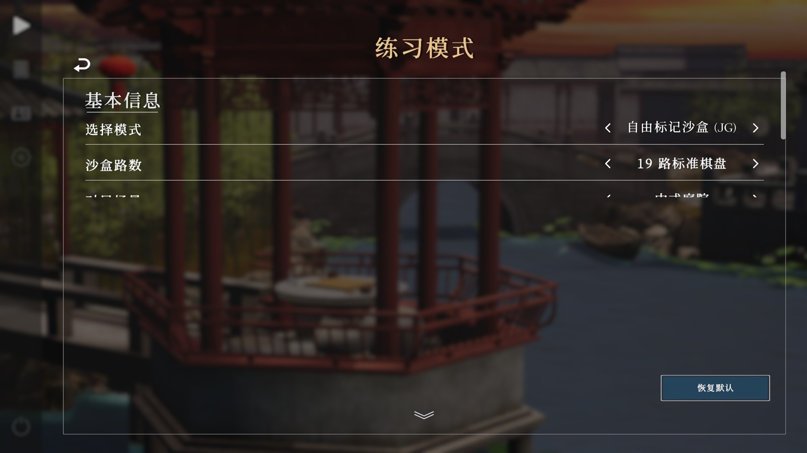
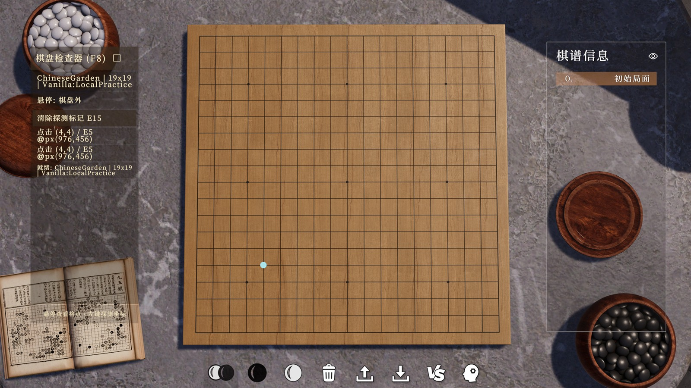
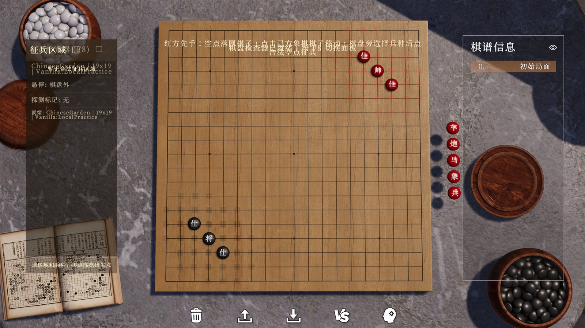

<div align="center">

# Just Gone

**《Just Go》通用 MOD 扩展框架（The Just Go Modding Extension）**

*一方棋盘，无限可能。*

[](https://github.com/MingqiZhang0/JustGone/releases/tag/v0.1.0)
[](#支持范围与限制)
[](LICENSE)
[](#环境要求)
[](#环境要求)
[](#环境要求)

[English](README.md) · **简体中文**

[为什么需要 Just Gone](#为什么需要-just-gone) · [快速开始](#快速开始) · [API 概览](#api-概览) · [实机展示](#实机展示) · [框架架构](#框架架构)

</div>

---

**Just Gone** 是面向 Unity 游戏《Just Go》的公共 BepInEx 5 / Harmony MOD 扩展框架。它在生态定位上参考了 REPENTOGON 的设计思想，但完全独立基于 C#、BepInEx 与 HarmonyX 实现。第三方 MOD 开发者只需引用 `JustGone.dll`，即可在不引用 `Assembly-CSharp.dll`、不编写重复 Harmony Hook 的前提下，注册自定义游戏模式、构建原生风格菜单与侧栏、查询棋盘坐标、渲染自定义棋子与 3D 标记，并与原版玩法及既有 MOD 安全共存。

当前版本为 **`v0.1.0`（Developer Preview / 开发者预览版）**。全部 12 组公共服务均由真实运行时代码实现，并已在隔离 Unity 环境中完成多 MOD 共存验收，但在 `1.0.0` 之前不承诺所有公共接口保持二进制兼容。

<p align="center">
  
</p>

## 为什么需要 Just Gone

过去为《Just Go》编写功能完整的 MOD，几乎每位开发者都不得不重复研究游戏内部 `Assembly-CSharp` 方法、棋盘坐标换算、`ModeSelection_LM` 模式路由、原生 `BasicPanel` 布局、输入拦截、场景生命周期与 Harmony 补丁优先级，还要担心不同 MOD 之间互相冲突或破坏原版存档。

Just Gone 将这些底层能力收口为可复用的公共接口与独立作用域，使第三方 MOD 无需直接触碰游戏内部程序集即可安全扩展玩法与工具。

| 常见 MOD 开发难题 | Just Gone 提供的能力 |
| --- | --- |
| 逆向研究棋盘坐标与射线拾取 | **Board API**（`JustGoneApi.Board`）：支持 9/13/19 路棋盘、GTP、局部/世界/屏幕坐标与射线拾取 |
| 创建自定义游戏模式 | **GameMode API**（`JustGoneApi.Modes`）：提供模式注册、会话生命周期与 Failsafe 异常退场 |
| 接入原生菜单与局内面板 | **Menu 与 UI API**（`JustGoneApi.Menu`、`JustGoneApi.UI`）：构建 `BasicPanel` 滚动配置页、镜像侧栏、Toast 与棋谱面板 |
| 管理自定义棋子与 3D 覆盖层 | **Piece 与 Rendering API**（`JustGoneApi.Pieces`、`JustGoneApi.Rendering`）：复用原生棋子模型、染色、CJK 字形、3D 标记与悬停幽灵棋子 |
| 处理多 MOD 之间的输入冲突 | **Input API**（`JustGoneApi.Input`）：提供 UI 遮挡/输入框焦点检测与多 MOD 引用计数原版输入锁 |
| 管理绑定场景的对象与字体资源 | **Scene 与 Resource API**（`JustGoneApi.Scene`、`JustGoneApi.Resources`）及按 LIFO 回收的 `ModContext` |
| 保护原版存档与既有 MOD 共存 | **SaveGuard API**（`JustGoneApi.Saves`）的 ES3 CAS 事务保护与 `Priority.High` 协作路由 |

## 快速开始

### 面向玩家（安装 Runtime）

1. 确保游戏目录已安装 **BepInEx 5**（`5.4.23.6`，含 `0Harmony 2.9.0.0`），并先退出《Just Go》。
2. 从 [v0.1.0 Release](https://github.com/MingqiZhang0/JustGone/releases/tag/v0.1.0) 下载 **`JustGone-v0.1.0-Runtime.zip`** 并解压。
3. 选择以下任一方式安装：
   - **推荐（带版本与 SHA-256 校验的事务性安装）：**
     ```powershell
     & '.\tools\install.ps1' -GameDir '<你的 Just Go 目录>' -From '.\plugins\JustGone\JustGone.dll' -ExpectedVersion '0.1.0.0' -ExpectedSha256 '<见 SHA256SUMS.txt>'
     ```
   - **手动安装：** 将 `plugins\JustGone\` 整个目录复制到 `<你的 Just Go 目录>\BepInEx\plugins\JustGone\`。
4. **卸载方式：** 退出《Just Go》，删除 `<你的 Just Go 目录>\BepInEx\plugins\JustGone\`（或执行 `tools/deploy-lib.ps1 -Mode Remove`）。不会修改原版游戏文件、原版存档或其他插件（如《围象棋》）。

### 面向 MOD 开发者（使用 SDK）

1. 从 [Releases](https://github.com/MingqiZhang0/JustGone/releases/tag/v0.1.0) 下载 **`JustGone-v0.1.0-SDK.zip`**，内含 `lib/net472/JustGone.dll`、XML 注释文档（`JustGone.xml`）、完整开发者文档与独立项目模板 `templates/JustGoneModTemplate/`。
2. 在 `net472` 项目中仅引用 `JustGone.dll`、`BepInEx.dll`、`UnityEngine.dll`、`UnityEngine.CoreModule.dll`（全部设为 `<Private>false</Private>`），无需引用 `Assembly-CSharp.dll` 或 `0Harmony.dll`。
3. 声明 `[BepInDependency(JustGoneApi.FrameworkGuid)]` 并注册独立 `ModContext`：

```csharp
using BepInEx;
using JustGone;
using JustGone.Core;
using UnityEngine;

namespace MyJustGoneMod
{
    [BepInPlugin("author.justgone.template", "My Just Gone Mod", "0.1.0")]
    [BepInDependency(JustGoneApi.FrameworkGuid)]
    public sealed class MyModPlugin : BaseUnityPlugin
    {
        private ModContext _ctx;
        private IMarkerLayer _markers;

        private void Awake()
        {
            _ctx = JustGoneApi.RegisterMod("author.justgone.template", "My Just Gone Mod", "0.1.0");
            _ctx.Log.Info("Template MOD initialized.");

            JustGoneApi.Events.OnGameReady(_ctx, OnGameReady);
            JustGoneApi.Events.OnBoardClicked(_ctx, OnBoardClicked);
            JustGoneApi.Events.OnGameLeaving(_ctx, _ => CleanupBoardResources());
        }

        private void OnGameReady(GameReadyEventArgs e)
        {
            CleanupBoardResources();
            _markers = JustGoneApi.Rendering.CreateMarkerLayer(_ctx, "template_markers");
            JustGoneApi.UI.ShowToast("My Just Gone Mod ready (" + e.BoardSize + "x" + e.BoardSize + ")", 2.5f);
        }

        private void OnBoardClicked(BoardClickEventArgs e)
        {
            if (e.PointerOverUi || e.MouseButton != 0 || !e.Coord.IsValid) return;
            _markers?.Clear();
            _markers?.SetMarker(e.Coord, Color.cyan, diameterScale: 0.85f);
            JustGoneApi.UI.ShowToast("Clicked " + e.Coord.ToGtp(e.BoardSize) + " " + e.Coord, 1.8f);
        }

        private void CleanupBoardResources()
        {
            _markers?.Dispose();
            _markers = null;
        }

        private void OnDestroy()
        {
            CleanupBoardResources();
            _ctx?.Dispose();
        }
    }
}
```

4. 编译完成后将生成的 `.dll` 放入 `<你的 Just Go 目录>\BepInEx\plugins\<你的MOD目录>\` 即可运行。关于自定义游戏模式、原生配置页与多 MOD 共存规范，请参阅 [开发者指南](docs/DEVELOPER_GUIDE.md)。

## API 概览

全部 12 组运行时服务均通过静态门面 `JustGoneApi`（`FrameworkGuid = "dev.justgone.framework"`）访问。完整签名与无 Unity 依赖的 `JustGone.Core` 类型请见 [API_CATALOG.md](docs/API_CATALOG.md)，逐接口验证状态请见 [PHASE2_ACCEPTANCE_REPORT.md](docs/PHASE2_ACCEPTANCE_REPORT.md)。

| 服务组 | 入口属性 | 功能简介 | 验证状态 |
| --- | --- | --- | --- |
| **Game** | `JustGoneApi.Game` | 对局状态、暂停状态、原版模式/环境查询、虚拟相机与安全返回主菜单 | 已实机验证（`PauseOrResume` / `TrySetCamera` 仅离线验证） |
| **Scene** | `JustGoneApi.Scene` | 当前场景查询与复用原版音乐淡出和加载屏的安全场景切换 | 已实机验证（非 `ChineseGarden` 场景待逐一复核） |
| **Board** | `JustGoneApi.Board` | 动态识别 9/13/19 路棋盘，提供局部/世界/屏幕坐标换算、GTP 转换、射线拾取与清子 | 已实机验证（仅棋盘场景可用） |
| **Piece** | `JustGoneApi.Pieces` | 独立原生棋子图层（染色、CJK 字形、缩放、落子动画与音效）及 3D 棋子展示架 | 已实机验证（`CreateDisplayShelf` / `Move` / `UpdateVisual` 仅离线验证） |
| **Rendering** | `JustGoneApi.Rendering` | 格点 3D 高亮标记、原生领地网格覆盖层与悬停幽灵棋子 | 已实机验证（`CreateGridOverlay` 仅离线验证，依赖场景 Prefab） |
| **Input** | `JustGoneApi.Input` | UI 指针遮挡与输入框焦点检测、多 MOD 引用计数原版输入锁、菜单滚轮吸收 | 已实机验证（`RegisterMenuWheelAbsorber` 仅离线验证） |
| **Menu** | `JustGoneApi.Menu` | 向主菜单 `ModeSelection_LM` 注册模式项与构建原生 `BasicPanel` 滚动配置页 | 已实机验证（仅主菜单练习模式面板生效） |
| **UI** | `JustGoneApi.UI` | 原生 Toast、常驻错误条、镜像折叠侧栏、Practice 按钮/棋谱、终局面板与原生保存框 | 已实机验证（`ShowSaveFileDialog` / `ShowGameOver` / `StickyError` 仅离线验证） |
| **GameMode** | `JustGoneApi.Modes` | 自定义游戏模式注册、启动编排、会话生命周期与 Failsafe 安全中止 | 已实机验证（同一时刻仅允许 1 个活动自定义模式） |
| **Event** | `JustGoneApi.Events` | 异常隔离事件总线，覆盖场景、对局就绪/离开、悬停、点击、按键、滚轮、暂停与原生按钮 | 已实机验证 |
| **Resource** | `JustGoneApi.Resources` | 动态 CJK/TextMeshPro 字体发现、原生资源可用性检查与独立 MOD 配置目录 | 已实机验证 |
| **SaveGuard** | `JustGoneApi.Saves` | 原版 `SaveFileOfficial_beta.es3` 的 Compare-And-Set 事务覆盖、安全回滚与启动对账 | 已实机验证（仅保护原版启动键） |

## 实机展示

[`src/Examples/`](src/Examples/) 中的两个独立示例 MOD 均在编译期验证**零直接引用** `Assembly-CSharp.dll`、`0Harmony.dll` 与 `JustGoWeiXiangQiP4.dll`。以下截图全部来自真实 Unity（`v1.2.0`）隔离验收运行，未对实际游戏画面做任何伪造修改。

### 自定义游戏模式（`JustGone.Example.CustomModeAndUi`）

向原版「练习模式」选择器注册自定义模式「自由标记沙盒 (JG)」，在原生 `BasicPanel` 中渲染滚动配置页；进入对局后生成黑白棋子、朱红染色带汉字「星」的自定义棋子与 9 枚星位 3D 标记，并接管原生侧栏、棋谱列表与悔棋/重开按钮。

<p align="center">
  
  
</p>

### 棋盘检查器（`JustGone.Example.BoardInspector`）

以无侵入方式与原版模式或自定义模式并行运行，在可按 `F8` 切换的原生侧栏中实时显示棋盘路数、环境、悬停格点、GTP 与屏幕像素坐标，并在点击时放置青色 3D 探测标记。

<p align="center">
  
</p>

### 与《围象棋》同进程共存

Just Gone 及两个示例 MOD 与独立版 **《围象棋》（`JustGoWeiXiangQiP4.dll` v0.10.10.0）** 在同一 Unity 进程内完整共存。原版模式 0/1、《围象棋》（索引 2）与 Just Gone 自定义模式（索引 3+）在 `ModeSelection_LM` 中互不覆盖、零冲突往返切换。

<p align="center">
  
</p>

## 框架架构

```text
第三方 MOD（独立 ModContext）
             |
   JustGoneApi（公共门面）
             |
      12 组运行时服务  <---->  JustGone.Core（纯逻辑层，零 Unity 依赖）
             |
内部集成层（JgPatches / JgBootstrap / JgMenuHost / JgGameBridge）
             |
    BepInEx 5 + HarmonyX + Unity Mono
             |
          Just Go
```

| 层次 | 目录 | 职责 |
| --- | --- | --- |
| **纯逻辑核心层** | [`src/JustGone.Core/`](src/JustGone.Core/) | 无 Unity 依赖的坐标（`BoardCoord`）、多 MOD `MenuRouteTable`、`SessionGuard`、CAS `SaveTransactionRules`、`AtomicFileWriter`、`MiniJson`、`PieceLedger<TData>` 与 `InputLockRegistry` |
| **公共门面与服务层** | [`src/JustGone/`](src/JustGone/)、[`src/JustGone/Services/`](src/JustGone/Services/) | `JustGoneApi`、`ModContext` 与 12 组运行时服务，屏蔽 `Assembly-CSharp` 私有类型 |
| **内部游戏集成层** | [`src/JustGone/Internal/`](src/JustGone/Internal/) | 集中管理 Harmony 补丁（`JgPatches`）、`DontDestroyOnLoad` 驱动（`JgBootstrap`）、主菜单托管（`JgMenuHost`）、反射桥接与 Failsafe |
| **示例与 SDK 模板** | [`src/Examples/`](src/Examples/)、[`templates/JustGoneModTemplate/`](templates/JustGoneModTemplate/) | 零 `Assembly-CSharp` 引用的示例 MOD 与独立开发启动模板 |

核心运行时不变量：
- **独立 `ModContext` 与资源所有权**：事件订阅、输入锁、棋子/标记图层、侧栏面板与菜单模式均绑定到对应 MOD，在 `Dispose()` 时按 LIFO 逆序自动回收。
- **事件异常隔离**：每个事件订阅者在独立 `try/catch` 中执行，单个 MOD 抛出异常不会阻断其他 MOD 或原版逻辑。
- **原版兼容与协作共存**：`TitleManager.LoadLocalMultiMatch` 使用 `Priority.High` 仅拦截 Just Gone 已注册模式，原版 0/1 与独立《围象棋》（索引 2）一律原样透传；初始化失败时仅调用 `harmony.UnpatchSelf()` 定向回滚。
- **原版存档保护（`SaveGuard`）**：启动自定义模式前通过 Compare-And-Set 备份并校验 `SaveFileOfficial_beta.es3`（备份独立存于 `BepInEx/config/dev.justgone.framework/es3-guard/`），退出或异常重启时自动恢复。

详细 Harmony 补丁清单与共存机制见 [ARCHITECTURE.md](docs/ARCHITECTURE.md)。

## 支持范围与限制

Just Gone `v0.1.0` 属于 **Developer Preview（开发者预览版）**，并非完全稳定的 `1.0` 生产版本。

| 方面 | 当前状态 |
| --- | --- |
| **已验证游戏与运行环境** | 《Just Go》v1.2.0（Unity 2021.3.29f1 Mono，Windows x64）、BepInEx 5.4.23.6、0Harmony 2.9.0.0 |
| **已验证棋盘路数** | 9×9、13×13、19×19 路棋盘的坐标转换与射线拾取均已实机验证 |
| **已验证多 MOD 共存** | 原版模式 0/1、《围象棋》v0.10.10.0（索引 2）、Just Gone 自由标记沙盒（索引 3）与 `BoardInspector` 同进程往返共存 |
| **自动化实机验收报告** | Phase 2 实机共 **65 条断言：63 通过、2 失败**；2 条失败均为测试脚本对原版 UI 选择器路数索引方向的预期反转（UI 为 `0=9, 1=13, 2=19`，ES3 为 `0=19, 1=13, 2=9`），三种路数均已实际进入并通过坐标往返验证 |
| **尚未交互验证的接口** | `ShowSaveFileDialog`（系统原生保存文件弹窗）、`ShowGameOver`、`CreateDisplayShelf`、`CreateGridOverlay`、`PauseOrResume`、`TrySetCamera` 已完成编译与离线检查，尚未在自动化实机中交互点击验证 |
| **API 稳定性** | 公共接口签名与命名空间在 `1.0.0` 前仍可能调整 |
| **已知界面与运行限制** | 多 MOD 同时镜像左侧栏或弹出 Toast 时会发生区域重叠（建议通过 `F8` 等热键或自定义锚点避让）；主菜单 `BasicPanel/List` 首次视口高度受首次进入的原版模式行数影响；默认英文 TMP 字体缺少 `▾`/`▸` 字形（渲染为 `□`）；同一时刻仅允许 1 个自定义游戏模式处于活动状态 |

完整实机证据与逐项 API 状态请见 [PHASE2_ACCEPTANCE_REPORT.md](docs/PHASE2_ACCEPTANCE_REPORT.md)。

## 环境要求

| 场景 | 依赖要求 |
| --- | --- |
| **运行环境（玩家）** | 《Just Go》v1.2.0（Windows x64，Unity 2021.3.29f1 Mono）· BepInEx 5.4.23.6（含 0Harmony 2.9.0.0） |
| **MOD 开发（SDK）** | 支持 `net472`（C# 8.0）的 .NET SDK · SDK 中的 `JustGone.dll` · 本地《Just Go》目录中的 `BepInEx.dll`、`UnityEngine.dll`、`UnityEngine.CoreModule.dll` |
| **框架源码构建** | 支持 `net472` 引用程序集的 .NET SDK 8/10+ · 本地已安装 BepInEx 5 的《Just Go》v1.2.0（仅作编译期 `Private=false` 引用） |

## 开发与构建

克隆仓库后，在仓库根目录执行构建、单元测试与部署事务自测：

```powershell
git clone https://github.com/MingqiZhang0/JustGone.git
cd JustGone

# 运行 JustGone.Core 单元测试（12/12）、编译框架与双示例 MOD（net472），
# 并校验示例 MOD 零 Assembly-CSharp / 0Harmony 引用与输出 SHA-256
& '.\tools\build.ps1'

# 在临时目录运行事务性安装与回滚自测（11/11 断言）
& '.\tools\test-deployment.ps1'

# 打包 Runtime / SDK / Examples 发行包并执行洁净度扫描与 SHA-256 清单生成
& '.\tools\package-release.ps1' -Version '0.1.0'
```

直接使用 `dotnet build` 时，可通过 `-p:GameDir="D:\Path\To\Just Go"` 覆盖 [`Directory.Build.props`](Directory.Build.props) 中的默认游戏路径。

**仓库目录导航：** [`src/JustGone.Core/`](src/JustGone.Core/) · [`src/JustGone/`](src/JustGone/) · [`src/Examples/`](src/Examples/) · [`templates/JustGoneModTemplate/`](templates/JustGoneModTemplate/) · [`tests/JustGone.Core.Tests/`](tests/JustGone.Core.Tests/) · [`tools/`](tools/) · [`docs/`](docs/) · [`CHANGELOG.md`](CHANGELOG.md)

## 路线图

`v0.1.0` 为首个 Developer Preview 基线版本。后续迭代将以真实 MOD 开发者需求为驱动，不为填满路线图而预先承诺未实现功能；候选方向包括多 MOD 左侧栏/Toast 槽位协调、原版棋盘只读落子监听、更多原生菜单扩展点与 `dotnet new` 脚手架模板。详见 [ROADMAP.md](docs/ROADMAP.md)。

## 贡献与安全

欢迎提交 Issue、Pull Request 与 MOD 兼容性报告。反馈兼容性问题时，请附上《Just Go》版本、BepInEx 版本、已安装插件列表及最小复现步骤。

**严禁提交或附带**原版游戏程序集（如 `Assembly-CSharp.dll`、`UnityEngine*.dll` 等）、真实玩家存档（`*.es3`）、API Key、凭据或私人本机运行日志。如发现潜在存档破坏风险或安全问题，请提交不含敏感附件的最小报告或直接联系维护者。

## 许可证与致谢

- **许可证**：Just Gone 原创源码与文档采用 [MIT License](LICENSE) 开源；第三方运行时依赖继续遵守各自许可证与条款，详见 [THIRD_PARTY_NOTICES.md](THIRD_PARTY_NOTICES.md)。
- **技术来源**：核心《Just Go》集成技术提取、解耦并泛化自维护者自有项目 **《围象棋》**（`JustGo_WeiXiangQi` v0.10.10.0），完整 58 文件追溯见 [SOURCE_REUSE_MATRIX.md](docs/SOURCE_REUSE_MATRIX.md)。Just Gone 对《围象棋》零运行时依赖，也不包含任何围象棋专用规则。
- **致谢**：感谢 [BepInEx 5](https://github.com/BepInEx/BepInEx)、[HarmonyX](https://github.com/BepInEx/HarmonyX)、Unity 与 Studio Amateur（《Just Go》）。

*Just Gone 是非官方社区 MOD 扩展项目，与《Just Go》原作者无隶属或官方合作关系。*
