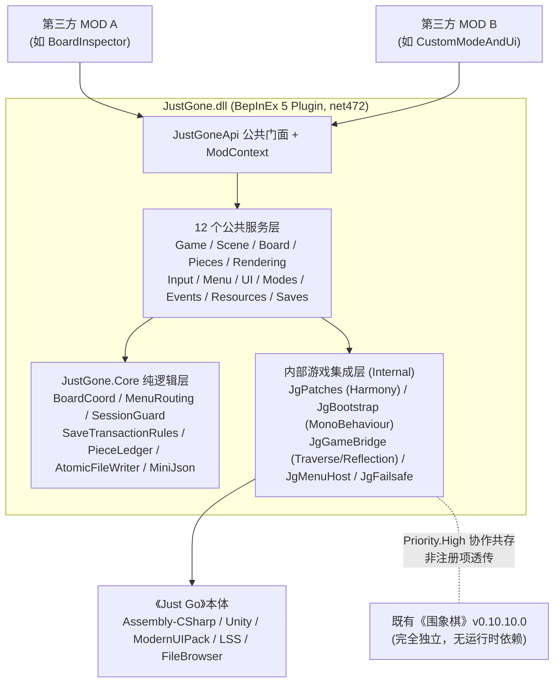

# Just Gone 框架架构设计（ARCHITECTURE）

## 1. 定位与核心目标

**Just Gone（The Just Go Modding Extension）** 是面向 Unity 游戏《Just Go》的通用 BepInEx 5 / Harmony 公共扩展框架（定位类比《以撒的结合》的 REPENTOGON）：

1. **隔离底层复杂度**：第三方 MOD 开发者只需引用 `JustGone.dll`（与 `BepInEx.dll`、`UnityEngine.CoreModule.dll`），**无需引用 `Assembly-CSharp.dll`，也无需自行编写重复的 Harmony Hook**。
2. **多 MOD 共存与资源隔离**：每个 MOD 通过 `JustGoneApi.RegisterMod(...)` 获取专属 `ModContext`，其注册的菜单项、自定义模式、事件订阅、输入锁、棋子图层、标记图层、UI 面板均绑定所有权并在 `Dispose()` 时自动回收。
3. **绝对保护原版与既有 MOD**：
   - 原版模式 0（好友约战）、1（自由摆谱）及其它原版玩法完全无侵入透传；
   - 与已安装的《围象棋》v0.10.10.0（`JustGoWeiXiangQiP4.dll`，菜单索引 2）零冲突共存；
   - 原版存档 `SaveFileOfficial_beta.es3` 受 Compare-And-Set 事务与启动对账保护，绝不吞掉玩家进度。

---

## 2. 分层架构

### 2.1 分层职责边界

| 层级 | 目录 | 依赖 | 职责 |
| --- | --- | --- | --- |
| **Pure Core 层** | `src/JustGone.Core/` | 仅 .NET BCL（**零 Unity/BepInEx 依赖**） | 坐标、路由、会话守卫、CAS 存档事务规则、原子写、MiniJson、泛型视图账本与 Delta 计划器、MOD 句柄与纯数据事件参数。100% 可离线单元测试。 |
| **Runtime Services 层** | `src/JustGone/Services/` | `JustGone.Core` + Unity + BepInEx | 实现全部 12 组公共 API，屏蔽 `Assembly-CSharp` 私有字段与内部枚举，维护多 MOD 隔离资源表。 |
| **Internal Integration 层** | `src/JustGone/Internal/` | Harmony + `Assembly-CSharp` | 集中持有所有 Harmony Hook、`DontDestroyOnLoad` 驱动、主菜单 `BasicPanel`/`ScrollRect` 托管与 Failsafe。 |
| **Public Facade 层** | `src/JustGone/JustGoneApi.cs`, `ModContext.cs` | Services + Core | 对外唯一稳定入口，控制版本兼容面与 per-MOD 作用域。 |

---

## 3. 与原版及《围象棋》v0.10.10.0 的 Harmony 共存机制

这是从《围象棋》v0.10.10.0 源码分析中识别出的最关键工程约束。

### 3.1 `TitleManager.LoadLocalMultiMatch` 路由冲突规避

《围象棋》v0.10.10.0 的 `Patch_LoadLocalMultiMatch`（默认 Harmony 优先级 `Priority.Normal = 400`）规则为：
- `index == 0` 或 `1` → `PassToVanilla`（返回 `true`）
- `index == 2`（围象棋配置索引）→ 启动围象棋（返回 `false`）
- `index >= 2 && index != 2` → `BlockUnsupportedIndex`（返回 `false` 并弹拦截提示）

**Just Gone 的共存设计**：
1. `JgPatches.Patch_JgLoadLocalMultiMatch` 声明 **`[HarmonyPriority(Priority.High)]`**（优先级 600，先于围象棋的 400 执行）。
2. 当 `selector.index` 命中 **Just Gone 自己向 `ModeSelection_LM` 注册的自定义模式**（严格同时校验动态分配索引与条目名称）：
   - Just Gone 接管启动该模式并返回 `false`，围象棋的 Prefix 不会收到该索引，不会误触发 `BlockUnsupportedIndex`。
3. 当 `selector.index` 未命中任何 Just Gone 注册模式（包括原版 0、原版 1、围象棋索引 2）：
   - Just Gone 返回 `true` 完整透传，原版与围象棋行为与未安装 Just Gone 时 100% 一致。

### 3.2 全部 Harmony Hook 清单与放行不变量

| 目标方法 | 补丁类型与优先级 | Just Gone 接管条件 | 透传保证（原版 & 围象棋） |
| --- | --- | --- | --- |
| `TitleManager.LoadLocalMultiMatch` | Prefix (`Priority.High`) | `selector.index` + 标题精确匹配 Just Gone 已注册模式 | 索引 0/1 与未注册索引（含围象棋 2）一律返回 `true` |
| `GameManager.UpdateMouseInput` | Prefix | 存在 Just Gone 活动模式（抑制原版输入）或有效输入锁令牌 | 无活动模式且无输入锁时返回 `true` |
| `GameManager.UpdateScrollWheel` | Prefix | 同上 | 同上 |
| `GameManager.UpdateKeyboardInput` | Prefix | 同上 | 同上 |
| `GameManager.UndoWrapper` | Prefix | 活动模式处理或 `OnNativeAction` 订阅者消费 | 否则返回 `true` |
| `GameManager.UndoStone` | Prefix | 同上 | 同上 |
| `GameManager.RestartGame` | Prefix | 同上 | 同上 |
| `GameManager.CopySGF` | Prefix | 同上 | 同上 |
| `GameManager.UpdateButtonsInPanels` | Postfix | 存在 Just Gone 按钮覆写状态 | 否则立即返回 |
| `MouseWheel.Update` | Prefix | Just Gone 主菜单滚动容器或注册滚轮吸收器处于可滚动区间 | 否则返回 `true`，不干扰原版翻页与围象棋配置页滚轮 |

### 3.3 初始化失败定向回滚（吸收 WXQ-P2-002 经验）

`JustGonePlugin.Awake()` 使用专属 `Harmony("dev.justgone.framework")` 实例：
- 仅在 `PatchAll`、ES3 未完成事务对账、`JgBootstrap.EnsureCreated()` 全部完成后才置位 `IsReady = true`；
- 任一步抛异常立即置位 `IsReady = false`，销毁 `JgBootstrap` 并恢复 `Application.runInBackground`，仅调用 `harmony.UnpatchSelf()` 定向撤销本框架补丁（**严禁调用静态 `UnpatchAll()`**）。

---

## 4. 生命周期、多 MOD 资源所有权与 SaveGuard

- **MOD 作用域**：每个 MOD 通过 `JustGoneApi.RegisterMod(...)` 获得 `ModContext`，创建的菜单模式、事件订阅、输入锁、棋子图层、标记图层、侧栏面板自动挂载到该上下文，在 `Dispose()` 时按 LIFO 逆序释放并隔离异常。
- **自定义模式会话**：通过 `SaveGuardService` 备份并校验 `SaveFileOfficial_beta.es3` 后写入启动参数 → 原版加载屏切换场景 → 等待 `isGameStarted == true` → 创建 `ModeSessionContext` → 退出或异常时自动清理资源并按 Compare-And-Set 恢复 ES3 快照。
- **备份隔离**：SaveGuard 备份与事务日志独立存放在 `BepInEx/config/dev.justgone.framework/es3-guard/`，与围象棋备份目录完全分离。
